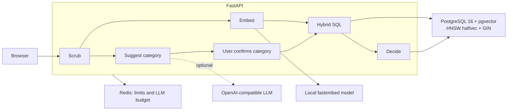

# TriageLens

Support teams receive duplicate tickets written in different words: keyword search misses paraphrases, while vector search misses opaque error codes. TriageLens triages bug reports, feature requests and client enquiries by scrubbing personal data, suggesting a category, and combining PostgreSQL full-text and pgvector search with Reciprocal Rank Fusion. Calibrated cosine thresholds decide whether to link a bug, add a feature vote, answer from an enquiry's FAQ, or ask a human to review. The optional LLM suggests labels; search, decisions and actions remain deterministic.

## Live demo

[Try TriageLens](https://3-25-14-19.sslip.io/triagelens/). The host may be stopped to save credits.

## What it shows

| Problem | Approach |
| --- | --- |
| Paraphrased duplicates | Semantic search finds tickets expressed in different words. |
| Opaque identifiers | Exact error-code matches are pinned above fused results. |
| Cross-category collisions | Search uses the confirmed category; other categories appear only as related results. |
| Lexical noise | Minimum-should-match filters weak matches after a GIN-friendly prefilter. |
| Duplicate decisions | Calibrated cosine thresholds separate automatic actions, review and new tickets. |
| ANN post-filtering | The ANN lab compares iterative scans with filtering after candidate collection. |
| PII leakage | Ordered patterns and checksum validators scrub text before embedding, storage or the LLM. |

## Architecture



Scrubbed ticket text is embedded locally; an unavailable model makes readiness fail rather than substituting fake semantics. A single SQL statement retrieves lexical and semantic candidates, pins exact codes and fuses ranks. Cosine to the best same-category candidate determines the verdict, and the user confirms the action. Redis enforces request limits and the LLM budget; invalid or unavailable LLM output falls back to rules.

## Calibration

The tables below come from [`eval/report.json`](eval/report.json), using `BAAI/bge-small-en-v1.5`. The labeled set has 31 tickets: 23 duplicates and 8 new tickets. These results are **in-sample**, on a small authored set used to choose the thresholds; they are not held-out accuracy estimates. The configured thresholds are 0.8 for automatic action and 0.7 for review, giving 21 correct auto-merges, 0 wrong merges, 4 reviews and 0 missed duplicates. The correct duplicate is the top candidate in 23 / 23 duplicate cases.

| Auto threshold | Review threshold | Correct auto-merges | Wrong auto-merges | Review | Missed duplicates |
| --- | --- | --- | --- | --- | --- |
| 0.8 | 0.7 | 21 | 0 | 4 | 0 |
| 0.78 | 0.7 | 21 | 0 | 4 | 0 |
| 0.75 | 0.7 | 23 | 1 | 1 | 0 |
| 0.735 | 0.735 | 23 | 1 | 0 | 0 |

The closest lookalike, “Dark mode for the web dashboard”, scores **0.7542**; the weakest real duplicate, “Profile picture upload hangs on my phone”, scores **0.7549**. That thin margin calls for more independently written tickets before production calibration or a meaningful held-out split.

| Ticket | Truth | Closest | Cosine | Verdict | Expected verdict | Expected master | Pass |
| --- | --- | --- | --- | --- | --- | --- | --- |
| Safari keeps logging us out with E_0X7F3A | BUG-109 | BUG-109 | 0.8314 | DUPLICATE | DUPLICATE | BUG-109 | True |
| Checkout fails at peak with ERR_PG_POOL_TIMEOUT_504 | BUG-101 | BUG-101 | 0.867 | DUPLICATE | DUPLICATE | BUG-101 | True |
| Password reset mail bounced with SMTP_RELAY_421 | BUG-103 | BUG-103 | 0.8719 | DUPLICATE | DUPLICATE | BUG-103 | True |
| Profile photo upload rejected with PAYLOAD_TOO_LARGE_413 | a different bug | BUG-112 | 0.797 | REVIEW | REVIEW | BUG-112 | True |
| Login times out with ERR_PG_POOL_TIMEOUT_504 | a different bug | BUG-101 | 0.7644 | REVIEW | REVIEW | BUG-101 | True |
| Report download fails with E_0X7F3A | a different bug | BUG-109 | 0.5372 | REVIEW | REVIEW | BUG-109 | True |

## Benchmark

100,000 template-generated tickets, 200 queries, on a laptop (i7-13700H, PostgreSQL 16.15, pgvector 0.8.7). Full tables, machine details and query plans are in [`bench/RESULTS.md`](bench/RESULTS.md). The templates give only 7,157 distinct texts, so recall counts ties by distance, and real ticket text may behave differently.

| Measurement | Result |
| --- | --- |
| HNSW recall@10, `ef_search` 40 (halfvec / float32) | 0.990 / 0.975, p50 about 1.0 ms |
| Enquiry filter (10% of rows), `ef_search` 40, iterative scan off | 7.1 of 10 rows returned, recall 0.708 |
| Same, `strict_order` / partial index | 10 rows, recall 0.982 / 1.000 |
| Full hybrid query, SQL only, All / Enquiries | p50 127 / 25 ms, p95 407 / 56 ms; lexical branch uses `intake_tsv_gin` |
| Query embedding | p50 7.9 ms |
| halfvec vs float32 HNSW size | 15.7 MB vs 27.7 MB |

## Local setup

Use the Python version pinned in [`.python-version`](.python-version), uv and Docker Compose. On a fresh checkout:

```bash
uv sync
cp .env.example .env
docker compose up -d
```

Keep an existing `.env` rather than overwriting it. Review `DATABASE_URL`, `REDIS_URL`, `MODEL_DIR` and the `TL_*_PORT` settings for your machine. The development defaults bind Postgres to loopback port `5434`, Redis to `6381` and the host app to `8400`; the Docker app profile uses `8410`.

The model cache lives outside the repository. Download the model once, temporarily allowing network access for that command:

```bash
uv run --env-file .env env HF_HUB_OFFLINE=0 python -c 'import os; from fastembed import TextEmbedding; TextEmbedding("BAAI/bge-small-en-v1.5", cache_dir=os.environ["MODEL_DIR"], threads=int(os.environ.get("EMBED_THREADS", "2")))'
```

Keep `HF_HUB_OFFLINE=1` in `.env` for normal operation, with `MODEL_DIR` pointing at that cache. Then migrate, seed, reproduce calibration and start the app:

```bash
uv run --env-file .env alembic upgrade head
uv run --env-file .env python -m app.seed_load --if-empty
uv run --env-file .env python -m eval.calibrate
uv run --env-file .env uvicorn app.main:app --port 8400 --workers 1
```

Open [the local app](http://127.0.0.1:8400/). Leave the `LLM_*` settings unset for rules-only classification; optional LLM classification requires `LLM_BASE_URL`, `LLM_API_KEY` and `LLM_MODEL` together.

Alternatively, the Docker app profile bakes the model into its image and uses the same database and Redis services:

```bash
docker compose --profile app build app
docker compose --profile app run --rm app alembic upgrade head
docker compose --profile app run --rm app python -m app.seed_load --if-empty
docker compose --profile app up -d app
```

The Docker profile sets `APP_ENV=prod`, so its session cookie requires HTTPS; put a TLS reverse proxy in front of its loopback port. Use the host development path above for plain HTTP locally.

## Tests

```bash
uv run pytest
uv run ruff check .
uv run ruff format --check .
```

Integration tests need running PostgreSQL with pgvector, Redis and the cached real embedding model. Set `TEST_DATABASE_URL` to the dedicated `triagelens_test` database and `TEST_REDIS_URL` to the test Redis database, as in `.env.example`; the fixtures migrate and seed the test database and clean session data between tests. They never substitute the hash embedder for the real model.

## Security and limits

| Control | Behavior |
| --- | --- |
| PII | Scrub before embedding, storage or the LLM; log metadata rather than ticket text. Names and street addresses are not detected. |
| Session isolation | Visitors see seed tickets and their own data; HttpOnly, SameSite=Lax cookies are Secure in production. Idle sessions expire after 24 hours; cleanup runs every 30 minutes. |
| Search | 120 requests per minute per IP. |
| Preview and ANN lab | Each allows 30 requests per minute per IP. |
| Commit | 30 requests per minute per IP; 50 created items per session. Votes do not create items. |
| LLM | 20 previews per hour per IP, then rules; daily shared budget defaults to 200 calls. LLM limits fail closed if Redis is unavailable; ordinary rate limits fail open. |
| Input and output | JSON-only POST bodies, 16 KiB body cap, strict schemas and string limits; LLM output uses validated enum fields and a summary capped at 120 characters. |
| Retries | Item commits require an Idempotency-Key; session reset is naturally idempotent. |
| SQL and browser | Bound parameters, whitelisted SET LOCAL values, CSP and textContent rendering. |
| Readiness and logs | Readiness checks the database, supported pgvector and warmed model, and reports Redis degradation; request logs contain timings, verdicts and redaction totals. |

## Design decisions

1. **One query, two retrievers:** lexical and semantic CTEs use GIN and HNSW on `halfvec(384)`, joined with a FULL OUTER JOIN for RRF in a single database round trip.
2. **OR plus minimum-should-match:** require half the distinct query terms, capped at 4, counting terms only after the GIN-friendly hits prefilter.
3. **Exact identifiers:** match error codes by equality and pin them above fused results.
4. **RRF ranks:** `k = 60` combines ranks across different score scales; the fused score is not a duplicate probability.
5. **Calibrated thresholds decide:** cosine ≥ 0.8 permits automatic action, 0.7–0.8 needs review, and lower similarity creates a new ticket; a code match guarantees at least review without lowering the automatic threshold.
6. **Category scopes actions:** users confirm the suggested category; cross-category matches are related results and never action targets.
7. **Iterative scans handle filters:** `hnsw.iterative_scan = strict_order` continues the graph search after filtering; category partial indexes are the benchmarked alternative.
8. **Show the real plan:** the small demo can correctly use a sequential scan; the ANN lab forces HNSW to demonstrate filtering, while a separate benchmark measures scale.
